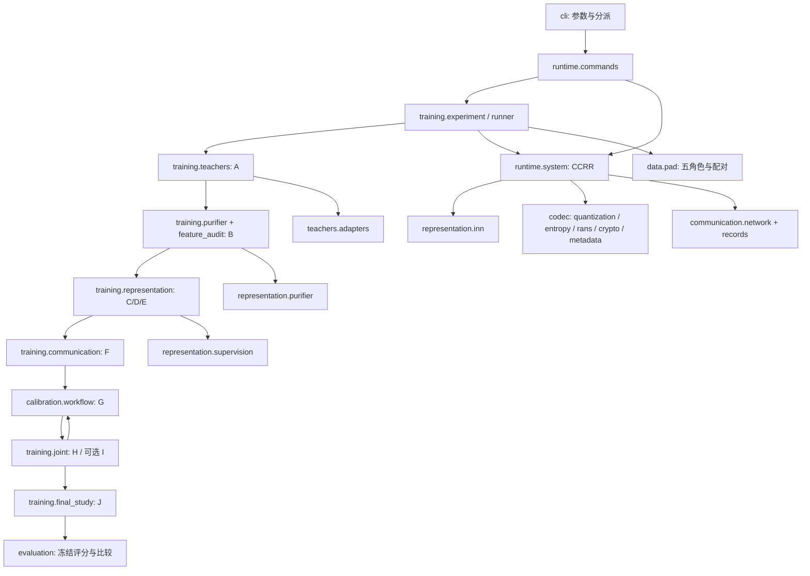

# PAD512-CCRR-v1.1 工程架构审查与受控重构

审查日期：2026-10-09。唯一研究依据是项目上级目录的《医学图像双能力授权系统_完整方案_V1修订版.md》。本次没有修改该文件、下载模型或启动正式训练。

## 1. 结论与边界

现有工程确实实现了 INN 分解、三档私有量化、有界 rANS、PAD-M1、独立 C/M AEAD、记录路由、神经 Writer/Decoder 以及训练阶段代码，并非只有空类或接口。接收路径从真实灰度 PNG 进入盲 Decoder，经认证后用整数 latent 和同一 INN 解析逆恢复 RGB，方向与最终稿一致。

但“模块存在”不等于“最终稿全部落实”。损失归一化、部分选点规则、标定背景、checkpoint 恢复和终评统计存在实质差距。重构完成后仍不能直接称为符合最终设计的可训练发布版本，也不能认为下载权重、填路径后便只剩计算任务。具体冲突和影响见[验证报告](03_完整验证报告.md)，按章节映射见[追踪表](02_设计代码追踪表.md)。

本次只调整职责、调用位置和公共机制的实现归属。未更改 INN 层数、宽度、Cayley 混合或数值式；未改变三个量化步长、CDF、rANS、记录、消息字段、密钥、nonce、AEAD、区域预算、输入尺寸、训练预算和准入阈值。未加入 OT/Sinkhorn、ECC、去写入网络或外部逐图私有 latent 文件。

## 2. 修改前保护和基线

原 `ccrr` 目录及其工作区均不是 Git 仓库，不能声称有一个原本干净的 Git 分支。因此先保存完整原目录归档、原文件摘要、设计稿摘要和调用清单，然后建立 Git 基线：

- 原始提交：`b2e8187`，分支 `baseline/original`。
- 独立工作分支：`refactor/pad512-v1.1-architecture`。
- 外部归档：`../audit/architecture_refactor_20261009/original_ccrr.tar.gz`；原始摘要在同目录 `baseline_manifest.json`。
- 原测试本次重跑：**26 passed, 1 skipped**；跳过项是未配置的可选 CompressAI 原生参照。历史 `verification/implementation_report.json` 原样保留，不作为本次测试结果。
- 原 512 smoke：连续逆最大误差 `1.1920928955078125e-07`，RMSE `2.2153120227130785e-08`；直接给正确记录的数字路径成功；真实未训练盲 Decoder 的 C/M 均为 `Extraction Failure`。

原始设计稿 SHA-256：`6319564fce9923f01d34f367e2e46ee20b9bf2dc90e0ae6a094f2863b9c5a549`。

## 3. 原结构的实际问题

1. `training.py` 约 2,000 行。`Experiment` 同时创建教师、读取数据、训练分类器、进行 Purifier 对抗、训练 INN、生成标定 probe、拟合 heads、选部署等级、管理 checkpoint 和触发终评。共享状态都挂在 `self` 上，局部修改难以判断影响哪些阶段。
2. `cli.main` 214 行，包含发送端风险图、凭证创建、实际编码写入、PNG 保存，以及接收认证结果保存和导出资源复制。参数解析与业务混在一起。
3. 量化表达式分布在熵模型、源编解码器、系统、训练选点和重建攻击中。现有式子一致，但缺乏唯一维护位置，容易日后出现二次量化或反量化规则分歧。
4. `runtime.py` 将 JSON/环境报告、优化器、学习率和 checkpoint 放在一起。发送端为加载 checkpoint 而依赖训练辅助函数所在文件。
5. `models/teachers.py` 为一个共享配对头依赖 Purifier 文件；终评训练文件内定义攻击模型并同时计算评测分数。职责边界不清晰。
6. CLI 与训练阶段各写一份 preflight，原训练版本只检查 PanDerm 源码摘要是否配置，没有像 CLI 版本一样验证源码文件的实际摘要。
7. `CounterLocal` 只包装标准库 `Counter`，没有协议或业务含义。

未发现源码模块级循环导入；原结构的问题主要是职责集中和隐式状态耦合，不能为解释重构而虚构循环导入。精确函数体重复检测只发现两个数据集的正常 `__len__`，主要重复风险是量化公式和资源检查，而非大量复制粘贴的整个函数。

## 4. 重构后的职责

| 子包/模块 | 权威职责 | 不承担的业务 |
|---|---|---|
| `data` | PAD 预处理、五角色加载、患者配对、教师输入适配；外部数据契约 | 不训练模型、不决定论文准入 |
| `teachers` | EfficientNet/ResNet/独立评价模型适配、PanDerm 固定源码与权重加载、冻结 | 不用 PanDerm 替代 Clinical Teacher |
| `representation` | 三尺度 INN、Purifier、来源 mask 和冻结教师监督 | 不把 Qid/Qsem 当成 ZC，不解析密文 |
| `codec` | 私有整数转换、概率模型/CDF、实际 rANS、PAD-M1、独立 AEAD/凭证/nonce | 不执行神经盲提取或路由 |
| `communication` | Carrier/Heads/Writer/Decoder 张量网络；记录语法、重组、M-first Router 和局部 C-first | Decoder 不输出连续 ZC；不持有密钥 |
| `runtime` | 组合发送/接收、PNG I/O、部署包、命令业务、资源检查、checkpoint 序列化、工程 smoke | 不组织 A–J 的研究选点 |
| `training` | 明确的 A–J 调度、各阶段优化、训练损失、独立读出/攻击者训练、优化器和证据状态 | 不复制编码或解析实现 |
| `calibration` | 风险响应、规范 probe、Wilson 标签、阈值/预算/排序选择、G 工作流 | 不将局部正确率当整图成功率 |
| `evaluation` | 指标、失败分母、配对比较、开发选点、真实 PNG 链路评分、冻结攻击评分 | 不反向更新被评价的系统 |
| `config.py` / `errors.py` | profile、配置/manifest、摘要与失败状态 | 不包含训练循环 |
| `tensor_ops.py` | 共用舍入、Haar、空间排列、masked SSIM、神经基础块/配对头 | 不选择科研超参数 |
| `cli.py` | argparse、入口分派、统一错误出口 | 不再编写 send/receive/export 业务 |

`training/losses.py` 是纯损失函数模块，监督和标定调用其中的 clinical/JS 函数，不会触发阶段训练。`calibration/workflow.py` 只依赖 `training/optimization.py` 的优化器工具；不存在回到 runner 的循环依赖。

没有建立旧路径兼容壳：内部 Python 路径属于未发布工程接口，使用者应按迁移表更新 import。`ccrr` 命令名、子命令/参数、checkpoint 格式、state_dict 键和部署文件格式保持原契约。为每个历史文件添加仅数行的转发模块会保留两套可见位置，本次没有这样做。

## 5. 实际数据与调用关系

图中的 G↔H 是研究工作流中的周期性重标定，**不是 Python 循环导入**。静态全模块导入（包括函数内部 lazy import）前后均未检出循环。原/新逐文件定义、导入和函数调用表达式见 [architecture.json](../verification/refactor/architecture.json)；动态 `experiment.system` 等接收者的真实职责由下列张量链核查补充，静态清单不声称可以自动解析所有动态类型。

### 5.1 发送与接收张量链

- 预处理：RGB → `x:[B,3,512,512]`、`v:[B,1,512,512]`、源有效矩形、`legal:[B,256]`。源像素摘要与数据清单比对。
- `INN.forward(x)` → `u:[B,1,512,512]`、`z:[B,2,512,512]`；`CCRR.decompose` → 8-bit 前向灰度 `g0`。私有排列为 `[B,128,64,64]`。
- `quantize_latent(z, Profile.step(r))` → 整数值 n；`SourceCodec.encode` → 48-byte 源头＋真实 rANS。`metadata.serialize` → 320 bytes。`seal` 分别产生 C 和固定 408-byte M。
- `CCRR.payload` 按固定质量顺序核算真实编码长度，选择可装入的完整候选。`route` 先全局放 M，再 C；每区域对选中的记录按 C-first/j 排序。输出 `[B,256,4,171]` 与 occupancy `[B,256,4]`。
- Carrier 和 heads 输出每区域 0–4 预算 logits、给定预算的可靠性。Writer 接受 G0、表、occupancy、legal，输出 Gpub 和 `[B,256,2,4]` gates；并非逐条能力各写一次像素。
- 接收唯一载体输入 `Gpub:[1,1,512,512]` → `Communication.read` → `[1,256,4,177]` logits → `logits_to_records` → `reassemble` → 两条独立 `open_stream`。
- C 认证后 `SourceCodec.decode` 恢复整数 n，反量化后 `CCRR.recover` 调用原 `system.inn.inverse`。M 认证后按 PAD-M1 解析。无合法凭证不能靠 RGB 恢复猜测数字对象。
- `receive_records` 是协议测试/内部拆分边界，允许直接给正确记录；它不是盲 Decoder 成功证据。部署入口 `receive` 不使用该 oracle 代替 `read(Gpub)`。

### 5.2 监督链

Clinical 是 EfficientNet-B0；MFM 是 PanDerm-Base，输出 `[B,768,14,14]`；ReID 是 ResNet-50。Purifier 内部 64 通道 Q 的 mask 划分是监督特征分支，与 `[B,2,512,512]` ZC 无关。`TeacherSupervision.targets(X)` 固定原图目标和来源 hard mask，`loss(G)` 使用该 mask 处理生成图 MFM 特征，教师参数冻结但生成输入保留梯度。

### 5.3 训练状态边界

`Experiment` 只保留共享资源、batch、日志、准入和快照绑定；`runner.run` 明确调 A/B/C/D/E/F/G/H/可选 I/J。阶段接收同一个实验上下文，不采用动态 mixin 注入。联合训练在同一模块内分成真实载荷缓存、消息梯度、表示梯度与最终选点；G 分成阈值样本、标定标签、heads 拟合和策略缓存刷新。

`FinalStudy` 仍是相对大的终评训练工作流（约 530 行）：独立分类器/攻击者有不同训练选择协议，保留在同一研究工作流中便于审计。其模型定义已移到 `evaluation.attacks`，源匹配/重建评分移到 `evaluation.attack_scoring`。未为了行数继续将同一算法割裂成小文件；最长残留函数约 156 行，主要是完整开发验收聚合，列为后续可维护性风险，不假称全部函数已经很短。

## 6. 明确发生的行为整理

- 统一 preflight 到原 CLI 的严格检查。训练现在也核验 PanDerm 源码实际 SHA-256，原来仅配置非空可能放行的情况会提前拒绝；保留训练报告的 `ready` / `training_started` 兼容字段。这是资源完整性检查统一，不改变教师结构或科研门槛。
- 文件迁移后输出目录定位从 `parents[2]` 调整为 `parents[3]`，仍指向同一个项目根，未改变存放协议。
- 私有量化/反量化统一到 `codec.quantization`，保留原运算顺序和 STE。Purifier 的有限特征量化仍独立。
- 原 `CounterLocal` 改为标准库 `Counter`；共享配对头、masked SSIM、攻击模型只是搬迁。
- 装饰器上下文逐一与原快照核对；迁移中发现的 `no_grad` 错位已经修正，比较结果包含装饰器。评分仍禁用梯度，攻击者训练没有误套 `no_grad`。

## 7. 可复核修改索引

- 逐文件迁移： [module_moves.json](../verification/refactor/module_moves.json)。其中 training 条目指最终共享上下文；各阶段方法的拆分去向以函数体等价性表和 architecture.json 为准。
- 完整修改清单： [changed_files.txt](../verification/refactor/changed_files.txt)。
- 函数体/装饰器等价性： [function_body_equivalence.json](../verification/refactor/function_body_equivalence.json)。274 项归一化一致；CLI.main、Experiment 初始化路径、preflight 三项明确审查差异；删除一个 Counter 包装函数。CLI 另行核对了解析器、错误出口及全部八个命令业务体，结果一致。
- 原/新模型初始化 state_dict： [model_state_equivalence.json](../verification/refactor/model_state_equivalence.json)，同种子逐键逐形状逐字节一致。
- 验证入口：`scripts/audit_architecture.py`、`scripts/verify_refactor_equivalence.py`、`scripts/verify_refactor.py`。不调用下载或正式训练。

## 8. 逐文件职责清单

此清单覆盖全部62个Python源码文件；包括标准包初始化文件，不把它们计作功能机制。原39个源码文件及调用关系保存在Git基线和architecture.json的before部分。

| 当前文件（相对src/ccrr） | 实际职责 | 行数 |
|---|---|---:|
| `__init__.py` | 包声明；不执行训练或协议逻辑 | 3 |
| `calibration/__init__.py` | 包声明；不执行训练或协议逻辑 | 1 |
| `calibration/probes.py` | 四象限选区、规范随机记录、临床风险、固定次数标签与阈值 | 303 |
| `calibration/routing.py` | 同密文的可靠性排序与行优先配对比较 | 118 |
| `calibration/workflow.py` | G阈值采集、标签集、head拟合、保守量及策略缓存 | 279 |
| `cli.py` | 参数解析、命令入口及错误序列化 | 69 |
| `codec/__init__.py` | 包声明；不执行训练或协议逻辑 | 1 |
| `codec/crypto.py` | 凭证、nonce数据库、独立AEAD及AAD | 198 |
| `codec/entropy.py` | 可微率代理、整数CDF导出、ZC源头与实际codec | 137 |
| `codec/metadata.py` | PAD-M1规范字段与320字节精确序列化 | 71 |
| `codec/quantization.py` | 私有latent唯一量化与反量化 | 20 |
| `codec/rans.py` | bounded rANS64及尾部bypass | 131 |
| `communication/__init__.py` | 包声明；不执行训练或协议逻辑 | 1 |
| `communication/network.py` | Carrier、Capacity/Reliability heads、Haar Writer、盲Decoder | 260 |
| `communication/records.py` | 171-bit记录、路由、packing、重组和logits语法解析 | 193 |
| `config.py` | Profile约束、YAML、资源摘要与manifest绑定 | 133 |
| `data/__init__.py` | 包声明；不执行训练或协议逻辑 | 1 |
| `data/external.py` | 外部分科数据和泛化层级契约 | 64 |
| `data/pad.py` | 预处理、教师尺寸适配、五角色数据集、有效batch拼接及患者对采样 | 242 |
| `errors.py` | 失败状态枚举、异常及断言 | 25 |
| `evaluation/__init__.py` | 包声明；不执行训练或协议逻辑 | 1 |
| `evaluation/attack_scoring.py` | 冻结源匹配/重建攻击评分及公开侧特征 | 151 |
| `evaluation/attacks.py` | 重建、属性、侧信道和全局特征攻击模型 | 155 |
| `evaluation/comparisons.py` | 配对临床、隐私点目标、视觉授权收益和FPR阈值 | 154 |
| `evaluation/deployment.py` | 开发单等级、共同成功集、策略与综合准入检查 | 228 |
| `evaluation/gates.py` | 部署开发点目标门禁 | 36 |
| `evaluation/joint_b.py` | 共同成功队列上的I接受/回退判据 | 54 |
| `evaluation/metrics.py` | 画质、临床、患者bootstrap、检索和失败分母 | 204 |
| `evaluation/optional_metrics.py` | 探索性LPIPS/FID/CLIP-IQA接口 | 101 |
| `evaluation/robustness.py` | 无重试有损通道和凭证矩阵工具 | 65 |
| `evaluation/runners.py` | 数据集级分类/身份与实际PNG收发评测 | 304 |
| `evaluation/selection.py` | C–E恢复与语义开发筛查 | 157 |
| `evaluation/source_privacy.py` | 开发P3来源/患者匹配多攻击证据 | 122 |
| `evaluation/structural_attacks.py` | 固定图库NCC/SSIM P1/P2评分 | 102 |
| `representation/__init__.py` | 包声明；不执行训练或协议逻辑 | 1 |
| `representation/inn.py` | INN解析正逆及固定灰度对照 | 103 |
| `representation/purifier.py` | 有限Q、mask、语义/身份分支及语义攻击器 | 83 |
| `representation/supervision.py` | 来源目标/mask、几何重叠对齐、冻结教师损失 | 136 |
| `runtime/__init__.py` | 包声明；不执行训练或协议逻辑 | 1 |
| `runtime/checkpoints.py` | 版本化state_dict/optimizer/RNG序列化 | 39 |
| `runtime/commands.py` | inspect/preflight/train/audit-data/export/send/receive/smoke业务入口 | 213 |
| `runtime/preflight.py` | 统一资源/源码实际摘要检查 | 40 |
| `runtime/smoke.py` | 明确区分oracle与实际盲提取的随机工程检查 | 83 |
| `runtime/support.py` | 随机种子/环境/JSON安全值和日志I/O | 86 |
| `runtime/system.py` | 模型组合、真实长度匹配、双流授权恢复、PNG保存重读 | 235 |
| `teachers/__init__.py` | 包声明；不执行训练或协议逻辑 | 1 |
| `teachers/adapters.py` | 三类教师及独立终评网络、严格权重加载、冻结 | 157 |
| `tensor_ops.py` | 共享数值/空间/Haar/SSIM和神经基础块 | 172 |
| `training/__init__.py` | 包声明；不执行训练或协议逻辑 | 1 |
| `training/adversarial.py` | 图像域配对对抗和容量筛选 | 101 |
| `training/attribute_study.py` | J年龄/性别辅助攻击训练与选择 | 201 |
| `training/communication.py` | F消息课程及局部表验证 | 160 |
| `training/experiment.py` | 共享数据/模型/凭证资源、证据门禁与快照 | 121 |
| `training/feature_audit.py` | B独立特征读出/身份攻击训练与准入 | 328 |
| `training/final_study.py` | J独立临床/攻击者优化及终评组织 | 527 |
| `training/joint.py` | H/I真实载荷缓存、梯度累积、端点/最终冻结 | 250 |
| `training/losses.py` | 训练损失与共享clinical/JS函数 | 97 |
| `training/optimization.py` | AdamW参数组、学习率和有限梯度更新 | 59 |
| `training/purifier.py` | B优化、来源域语义视图、局部身份阈值 | 238 |
| `training/representation.py` | C/D/E率失真和监督优化 | 137 |
| `training/runner.py` | 显式阶段顺序、依赖恢复、失败退出和J入口 | 156 |
| `training/teachers.py` | A教师/对照/probe/ReID训练与选择 | 374 |

### 配置、脚本和测试

| 文件/目录 | 职责及本轮处理 |
|---|---|
| `configs/pad512.yaml` | 唯一默认研究配置；字节未变，所有权重仍为空 |
| `pyproject.toml` | 依赖/包发现/ccrr入口；未变 |
| `requirements-local-macos.lock` | 原本机环境锁；未变，不冒充H100环境 |
| `scripts/fetch_official_weights.py` | 原官方权重下载辅助；未调用、未变 |
| `scripts/run_registered_matrix.py` | 原四组合配置生成/显式执行；未调用正式训练、未变 |
| `scripts/verify_implementation.py` | 历史验证工具，原样保留；本轮使用新脚本避免覆盖历史报告 |
| `scripts/audit_architecture.py` | 新增：基线/当前定义、调用表达式、导入图、函数长度和精确重复扫描 |
| `scripts/verify_refactor_equivalence.py` | 新增：函数体/装饰器/CLI业务体与基线对照；未登记差异会失败 |
| `scripts/verify_refactor.py` | 新增：统一工程验证、预期失败状态和机器报告，不启动训练 |
| `tests/test_baseline.py` | 原固定灰度对照可逆性；只改import |
| `tests/test_models.py` | 原模型/教师/通信/Purifier张量和梯度；只改import和格式 |
| `tests/test_protocol.py` | 原序列化/密钥/nonce/记录/rANS边界；只改import |
| `tests/test_integration.py` | 原真实协议组合、资源篡改、metric/calibration和固定向量；只改import/模块位置 |
| `tests/test_training_contract.py` | 原训练更新、冻结输入梯度、患者配对及失败门禁；只改import |
| `tests/test_refactor_contract.py` | 新增512非平凡逆/梯度、全包CLI、三档量化、下一步checkpoint、分派和真实未训失败 |
| `tests/test_known_design_gaps.py` | 新增D01/D03/D04的strict xfail；不降低原测试门槛 |
| `tests/fixtures/` | 原官方固定字节向量；未修改 |
| `verification/implementation_report.json` | 原历史报告；字节未变 |
| `verification/refactor/` | 本轮基线/过程/最终检查、摘要、映射和差异证据；无真实key/权重/患者字段 |
| `README.md`、`docs/` | 更新运行边界和结构；四份本轮报告，不改研究设计稿 |
